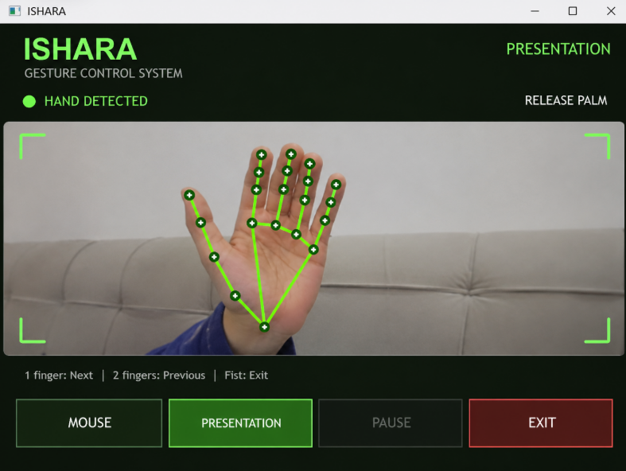

# ISHARA

### AI-Powered Hand Gesture Control System

**Software Engineering · Computer Vision · Human-Computer Interaction**



ISHARA is a Windows desktop application that enables hands-free computer control using real-time hand tracking and gesture recognition. It transforms webcam-detected gestures into mouse actions and presentation commands.

## Features

- **Mouse Control:** Move the cursor, left-click, right-click, and scroll using hand gestures.
- **Presentation Mode:** Navigate slides without a keyboard or mouse.
- **Gesture-Based Switching:** Switch modes using an open palm and return to Mouse Mode with a closed fist.
- **Live Feedback:** View hand landmarks, tracking status, and interactive controls.
- **Windows Desktop App:** Run the packaged application without installing Python.

## Gesture Controls

| Gesture | Action |
|---|---|
| Index finger movement | Move cursor |
| Thumb + index pinch | Left click |
| Thumb + middle pinch | Right click |
| Index + middle fingers | Scroll in Mouse Mode |
| Open palm (hold) | Switch modes |
| Index finger raised | Next slide in Presentation Mode |
| Index + middle fingers raised | Previous slide in Presentation Mode |
| Closed fist (hold) | Return to Mouse Mode |

## System Architecture

```text
Webcam → OpenCV → MediaPipe Hand Landmarks
                         ↓
                 Gesture Interpretation
                         ↓
                  Application State
                         ↓
             PyAutoGUI Desktop Actions
```

ISHARA integrates a pretrained MediaPipe hand-landmark model with custom gesture logic, real-time interaction handling, and a desktop interface. Its engineering work includes software integration, state management, testing, and Windows packaging.

## Tech Stack

**Python** · **OpenCV** · **MediaPipe** · **PyAutoGUI** · **PyInstaller**

## Download & Installation

### Windows App

A downloadable Windows build will be published under [GitHub Releases](https://github.com/Ghala77-prog/ISHARA/releases).

Once available, download and extract the Windows ZIP, then run `ISHARA.exe`. Keep the `_internal` folder beside the executable. A webcam and camera permissions are required.

### Run from Source

Requires Windows, Python 3.12, and a webcam.

```bash
git clone https://github.com/Ghala77-prog/ISHARA.git
cd ISHARA
pip install -r requirements.txt
python main.py
```

## Developer

**Ghala Alharbi** — Data Science Graduate

[Portfolio](https://ghala77-prog.github.io/ghala-portfolio/) · [GitHub](https://github.com/Ghala77-prog)

---

**ISHARA — Control your computer with a gesture.**